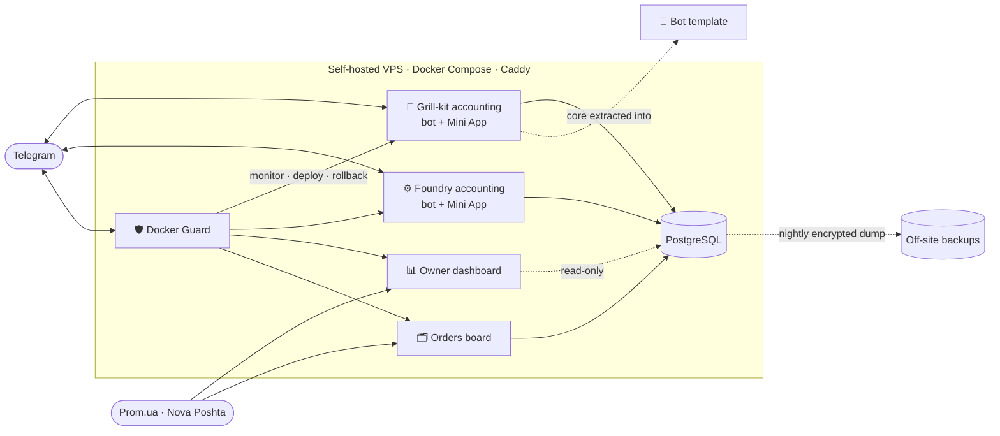
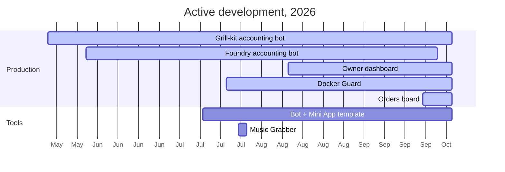

<h1 align="center">Hi there, I'm Toksa 👋</h1>

  <i>Python backend developer · Telegram bots &amp; Mini Apps · PostgreSQL · self-hosted ops · Cybersecurity student</i>

  
  
  
  
  
  
  
  

---

I build **production systems that real businesses run on**: Telegram bots that replace paper
accounting, Mini Apps that mirror them one-to-one, the owner's dashboard on top of them, and the
tooling that keeps it all alive on a self-hosted server. Alongside that I study **cybersecurity**:
networks, secure configuration and hands-on InfoSec practice.

**2026 so far:** 7 projects · ~490 commits · 5 of them running in production every day.

## 🗺️ How my projects fit together

Two small manufacturers run their day on these systems. Everything lives on one VPS that I set up
and maintain myself.

## 📅 Timeline

## 🆕 What changed since summer

- **Off the cloud, onto my own server.** Both accounting bots moved from Neon to a self-hosted
  PostgreSQL in a private Docker network, with nightly dumps, an encrypted disaster-recovery
  snapshot and a tested restore onto a fresh machine.
- **New: owner dashboard** — one read-only view across both businesses, with a live animated
  shop-floor plan and alerts when production data hasn't been entered.
- **New: Docker Guard** — a Telegram "control panel" for the server: monitoring, deploys with
  automatic rollback, maintenance mode and a panic button, dangerous actions behind TOTP.
- **New: orders board** — a Keep-style board for a small team, with a shared live drawing canvas.
- **Simpler grill-kit bot.** Marketplace integration and the manager approval queue were removed
  on purpose; the Mini App got a Telegram-native redesign with batch entries and drafts.
- **Security pass across everything:** a full audit, hardened containers (non-root, all
  capabilities dropped, read-only where possible), rotated tokens, tightened sudo rules.

## 🚀 What I Do

- 🐍 **Backend & Automation** — async Python (aiogram 3, asyncpg, aiohttp), event-sourced
  PostgreSQL schemas, background loops, external API integrations.
- 📱 **Telegram Mini Apps** — aiohttp server + vanilla-JS frontend inside the bot process,
  HMAC `initData` validation as the single trust boundary, full feature parity with chat.
- 📊 **Internal web apps** — dashboards and team tools on aiohttp + vanilla JS, no build step.
- 🛡️ **Cybersecurity** — hardening, least privilege, 2FA, intrusion detection, incident-response
  runbooks; secrets never reach the frontend.
- 🐧 **Linux & DevOps** — VPS, Docker Compose, Caddy, systemd, backups and disaster recovery.
- 🖥️ **Desktop apps** — Electron + Node, media pipelines on `yt-dlp` / FFmpeg.

## 🛠️ Tech Stack

| | |
|---|---|
| **Languages** | Python · JavaScript · SQL · Bash · C++ *(learning)* |
| **Backend** | aiogram 3.x · asyncio · aiohttp · asyncpg |
| **Databases** | PostgreSQL (self-hosted) · event sourcing, views, SQL functions, migrations |
| **Frontend** | Telegram Mini Apps · vanilla JS · HTML/CSS · SVG · PWA — no build step |
| **Desktop** | Electron · Node.js · yt-dlp · FFmpeg |
| **Docs & data** | openpyxl · WeasyPrint · Jinja2 · matplotlib |
| **Ops & security** | Linux · Docker Compose · Caddy · systemd · fail2ban/ufw · TOTP · Wireshark · Cisco basics |

## 📌 Projects

> Client systems are closed source — below is what they do and how they're built.

### 🍖 Grill-kit accounting — Telegram bot + Mini App

Production and warehouse accounting for a grill-kit manufacturer, used every day.

- **Event-sourced PostgreSQL:** no stored balances — stock is computed from append-only
  operations, so there's a full audit trail and point-in-time reports such as a stock audit.
- **One process, two interfaces:** an inline-keyboard chat bot and a Telegram Mini App with strict
  parity — same rights, same rules; money figures hidden from non-admin roles on the server.
- **Atomic batch entries:** many items in one transaction with ordered advisory locks (no
  deadlocks) and a 15-minute undo that removes the whole batch.
- **Payroll:** hours × rate + bonus − advance, closed sheets can be reopened, Excel/PDF export.
- Kit builder from a bill of materials, stock audit with printable blanks, bulk import,
  reorder forecasting, charts, digests and reminders when production isn't entered.
- Non-root, capability-dropped container; migrations applied on deploy; nightly backups with a
  hardened restore.

`aiogram 3` · `aiohttp` · `asyncpg` · `PostgreSQL` · `WeasyPrint` · `openpyxl` · `matplotlib`

---

### ⚙️ Foundry accounting — Telegram bot + Mini App

The same engine retargeted at a metal-casting foundry — a study in reusing a core across domains.

- Production chain **intake → flask packing → knockout → assembly → sale**, each stage a DB event.
- A flask is a batch (header / contents / knockout): one metal per flask, knocked out in one go.
- Hard overflow guard `good + defect ≤ quantity`, enforced atomically with `FOR UPDATE`.
- Metal consumption = Σ(good × weight × burn-loss); the coefficient lives in one SQL function
  shared by views and reports, so they can never disagree.
- Real-world edge cases: partial knockout carries leftovers into a new batch, flask top-ups,
  assembled products expanded into parts at sale time.
- Stock audit with printable blanks, stock-on-date snapshots, a daily journal with admin undo,
  Mini App parity; nightly encrypted disaster-recovery snapshot of the whole server.

`aiogram 3` · `asyncpg` · `PostgreSQL views & SQL functions` · `aiohttp` · `Docker`

---

### 📊 Owner dashboard — web

A read-only dashboard that puts both businesses on one screen for the owner.

- Sales, stock, margin, production stages and payroll from two production databases.
- Honest numbers: unknown cost stays *unknown* instead of zero, with a coverage indicator.
- Home page is a live SVG **shop-floor plan** — every animation reflects real data.
- Telegram alert only when production data hasn't been entered, counting how many workdays
  the gap has lasted; a phone "traffic light" page that works offline (PWA).
- Marketplace orders and parcel statuses, CSV/Excel export.
- Role-based views, two-factor login, strictly read-only DB role; stale-while-revalidate cache
  and per-minute caps keep the production databases calm.

`aiohttp` · `asyncpg` · `PostgreSQL` · `vanilla JS` · `SVG` · `Docker` · `Caddy`

---

### 🛡️ Docker Guard — server control panel in Telegram

Watches the VPS and runs the projects on it from a phone.

- Container and host monitoring — crashes, OOM, health checks, load, site uptime — with noise
  control: digests, quiet hours and collapsing alert "storms".
- **Project control panel:** maintenance mode in one tap, a panic button that closes everything,
  deploys with health checks and automatic rollback, a safety net for databases.
- Dangerous actions behind TOTP, with replay and brute-force protection.
- Automatic defence with GeoIP, auto-ban and an allow-list so the owner never gets locked out.
- Watches itself: an independent watchdog and protection against two copies running on one token.
- Least privilege between the bot, root-owned tools and the repo; incident-response runbook.

`Python` · `aiogram 3` · `Docker SDK` · `systemd` · `fail2ban` · `ufw` · `Caddy`

---

### 🗂️ Orders board — web

A Keep-style orders board for a small team.

- Order cards that turn yellow, then red as they age; status workflow, archive, shared pins.
- Lines priced from a read-only marketplace catalog sync, with editable price and auto total.
- Shared vector **drawing canvas** (pen, text, eraser with undo, several sheets), live for
  everyone via Server-Sent Events.
- Optimistic-lock conflict detection, per-order history, hashed session tokens, CSRF, login rate
  limiting, strict CSP; read-only Docker container, migrations on start.

`aiohttp` · `asyncpg` · `PostgreSQL` · `SSE` · `vanilla JS` · `pytest`

---

### 🧩 Telegram bot + Mini App template

The core of the accounting bots, extracted and depersonalised so a new project starts in an hour.

- One asyncio process: chat bot and Mini App share one business-logic layer.
- Server-side `initData` HMAC validation, role checks on the server, restores that never run
  uploaded SQL.
- Event-sourcing schema, approval queue, scheduled backups, feature flags, maintenance mode,
  developer panel; hardened Docker setup.

`aiogram 3` · `aiohttp` · `asyncpg` · `PostgreSQL` · `vanilla JS` · `Docker`

---

### 🎵 [Music Grabber](https://github.com/Toksa88/yt) — desktop music app (Electron)

Search, stream and download music with proper tags and artwork. Ukrainian UI.

- One search across **YouTube Music, YouTube, SoundCloud, iTunes and MusicBrainz**, with artist
  and album pages and full discographies.
- Streams straight from results: visible queue, shuffle, repeat, lyrics, radio, system media keys.
- Downloads named `Artist - Title`, square-cropped embedded cover, filled tags; whole albums as
  one job; automatic retries on 403/429/timeouts.
- Library reads tags straight from files — no hidden database; tag editor with batch rename.
- Discord Rich Presence; queue restored after restart.
- Installer ships yt-dlp and FFmpeg; yt-dlp updates itself daily, the app auto-updates from
  GitHub Releases. Honest about limits: Spotify / Apple Music are DRM-protected.

`Electron` · `Node.js` · `yt-dlp` · `FFmpeg` · `electron-builder`

---

<h2>🇺🇦 Українською</h2>

 

Роблю **системи, на яких реально працює бізнес**: Telegram-боти, що замінюють паперовий облік,
Mini App до них із повним паритетом, дашборд власника поверх них і інструменти, що тримають усе
це живим на власному сервері. Паралельно вчуся на **кібербезпеці**: мережі, захищені
конфігурації, практика з InfoSec.

**2026 рік:** 7 проєктів · ~490 комітів · 5 із них щодня працюють у продакшні.

Схеми вище — карта проєктів і часова шкала — однакові для обох мов.

### 🆕 Що змінилося з літа

- **З хмари — на власний сервер.** Обидва боти обліку переїхали з Neon на власний PostgreSQL у
  закритій Docker-мережі: щонічні дампи, зашифрований зліпок для аварійного відновлення й
  перевірене розгортання на чистій машині.
- **Новий дашборд власника** — один read-only екран для обох бізнесів, жива анімована схема цеху
  й тривоги, коли виробництво не внесене.
- **Новий Docker Guard** — «пульт» сервера в Telegram: моніторинг, деплой з автовідкатом, техроботи
  й кнопка паніки, небезпечні дії за TOTP.
- **Нова дошка замовлень** — у стилі Keep для невеликої команди, зі спільним живим полотном.
- **Простіший бот гриля.** Інтеграцію з маркетплейсом і чергу підтверджень менеджера свідомо
  прибрано; Mini App отримав новий Telegram-дизайн з пакетними операціями й чернетками.
- **Безпека всюди:** повний аудит, захищені контейнери (не root, без capabilities, read-only де
  можна), перевипущені токени, жорсткіші правила sudo.

### 🚀 Чим займаюсь

- 🐍 **Бекенд і автоматизація** — асинхронний Python (aiogram 3, asyncpg, aiohttp),
  event-sourced схеми PostgreSQL, фонові цикли, інтеграції зі сторонніми API.
- 📱 **Telegram Mini Apps** — aiohttp-сервер + vanilla-JS фронт у тому ж процесі, що й бот;
  HMAC-валідація `initData` як єдина межа довіри, повний паритет із чатом.
- 📊 **Внутрішні вебзастосунки** — дашборди й командні інструменти на aiohttp + vanilla JS.
- 🛡️ **Кібербезпека** — хардненінг, мінімальні привілеї, 2FA, виявлення вторгнень, план
  реагування на інциденти; жоден секрет не потрапляє на фронт.
- 🐧 **Linux і DevOps** — VPS, Docker Compose, Caddy, systemd, бекапи й аварійне відновлення.
- 🖥️ **Десктоп** — Electron + Node, медіапайплайни на `yt-dlp` / FFmpeg.

### 📌 Проєкти

> Клієнтські системи — закритий код; нижче лише що вміють і як побудовані.

**🍖 Облік виробництва наборів для гриля — бот + Mini App** *(у продакшні)*
- Event-sourced PostgreSQL: залишки не зберігаються, а обчислюються з операцій — повний аудит і
  звіти на будь-яку дату, як-от інвентаризація.
- Один процес, два інтерфейси з жорстким паритетом; гроші приховано від не-адмінів на сервері.
- Пакетні операції в одній транзакції з упорядкованими advisory-блокуваннями й скасуванням
  цілої пачки протягом 15 хвилин.
- Зарплата (години × ставка + премія − аванс), повторне відкриття відомості, Excel/PDF.
- Конструктор наборів зі специфікацій, інвентаризація з бланками, імпорт, прогноз закупівель,
  графіки, зведення й нагадування, якщо виробництво не внесене.

**⚙️ Облік ливарного виробництва — бот + Mini App** *(у продакшні)*
- Ланцюг **прихід → забивка опоки → вибивка → збірка → продаж**, кожна стадія — подія в БД.
- Опока як партія, один метал на опоку; захист `гуд + брак ≤ кількість` через `FOR UPDATE`.
- Витрата металу = Σ(гуд × вага × угар), коефіцієнт — в одній SQL-функції для view і звітів.
- Часткова вибивка переносить залишок у нову партію, дозабивка, збірні вироби розкладаються при продажу.
- Інвентаризація з бланками, склад на дату, журнал дня з відкатом, паритет Mini App,
  щонічний зашифрований зліпок усього сервера.

**📊 Дашборд власника** *(у продакшні)*
- Продажі, склад, маржа, стадії виробництва й зарплата з двох баз на одному екрані.
- Невідома собівартість лишається невідомою, а не нулем.
- Головна — жива SVG-схема цеху; тривога в Telegram, лише коли дані не внесені;
  «світлофор» для телефона з офлайн-режимом.
- Ролі, вхід із другим фактором, роль БД лише на читання, кеш і ліміти, що бережуть бази.

**🛡️ Docker Guard — пульт сервера в Telegram** *(у продакшні)*
- Моніторинг контейнерів, хоста й сайтів зі зведеннями, тихими годинами й згортанням «штормів».
- Техроботи, кнопка паніки, деплой з перевіркою здоров'я й автовідкатом.
- Небезпечні дії за TOTP; автобан із GeoIP і білим списком; власний watchdog.

**🗂️ Дошка замовлень** *(у продакшні)*
- Картки, що жовтіють і червоніють із віком, статуси, архів, спільні закріплення.
- Ціни з каталогу маркетплейсу; спільне полотно для малювання, живе через SSE.
- Оптимістичні блокування, історія змін, CSRF, ліміт входів, суворий CSP.

**🧩 Шаблон бот + Mini App** — ядро ботів обліку, з якого новий проєкт стартує за годину.

**🎵 [Music Grabber](https://github.com/Toksa88/yt)** *(відкритий код, MIT)*
- Пошук по YouTube Music, YouTube, SoundCloud, iTunes і MusicBrainz; сторінки виконавців і альбомів.
- Програвання з результатів, черга, радіо, текст пісні, медіаклавіші.
- Файли `Виконавець - Назва` з тегами й квадратною обкладинкою; цілі альбоми одним завданням.
- yt-dlp і FFmpeg вшиті в інсталятор; yt-dlp оновлюється сам щодоби, застосунок — з GitHub Releases.

## 📫 Contact

  
  

